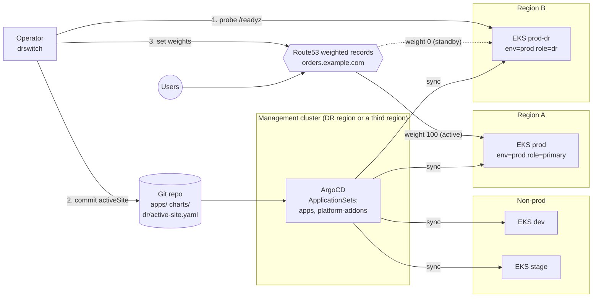
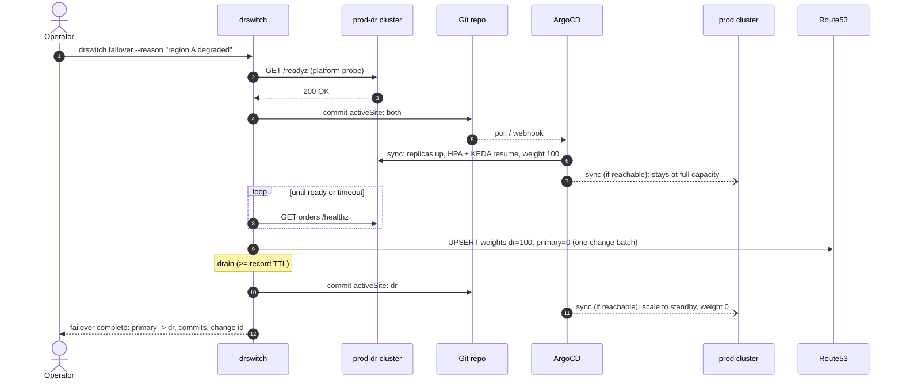

# gitops-multicluster-dr

[](https://github.com/ozy31/gitops-multicluster-dr/actions/workflows/ci.yml)
[](LICENSE)

A reference layout for running the same workloads on **dev, stage, prod and
prod-dr** EKS clusters from one Git repository with ArgoCD ApplicationSets,
plus a **single switch** for disaster recovery: one value in Git
(`dr.activeSite`) decides which prod site runs full capacity and receives
traffic. `drswitch`, a small Go CLI, flips that value safely: it
health-checks the target, scales it up, waits for it to become ready, moves
the Route53 weights, drains, and only then scales the old site down.

The pattern comes from running ArgoCD matrix generators across a set of EKS
clusters in production. Everything here is generic: placeholder accounts,
`example.com` domains, and [podinfo](https://github.com/stefanprodan/podinfo)
as a stand-in workload.

- [Architecture](#architecture)
- [Repository layout](#repository-layout)
- [How the matrix generator works](#how-the-matrix-generator-works)
- [The single switch](#the-single-switch)
- [drswitch](#drswitch)
- [Failover sequence](#failover-sequence)
- [Runbook](#runbook)
- [Sync waves and progressive sync](#sync-waves-and-progressive-sync)
- [Try it locally with kind](#try-it-locally-with-kind)
- [Design notes and limitations](#design-notes-and-limitations)
- [Development](#development)

## Architecture



- **One repo, many clusters.** ArgoCD learns about clusters from cluster
  Secrets. Their labels (`env`, `role`, `region`) are the only thing that
  differs between dev and prod-dr; the ApplicationSets turn those labels into
  Helm value files.
- **One flag.** `dr/active-site.yaml` is passed to every app as an extra values
  file. On the prod pair, the chart compares `dr.activeSite` with the cluster
  `role`: the active site runs full capacity with autoscaling and gets DNS
  weight 100; the standby runs `standbyReplicas` (0 by default) with weight 0.
- **ArgoCD must outlive the primary region.** If the management cluster lived
  in region A, losing region A would also take away the tool you need to scale
  up region B. Run it in the DR region or a third region.

## Repository layout

```text
.
├── bootstrap/
│   ├── root-app.yaml            # app of apps -> applicationsets/
│   ├── argocd/values.yaml       # argo-cd Helm values for the management cluster
│   └── clusters/                # example cluster Secrets (labels drive everything)
├── applicationsets/
│   ├── projects.yaml            # AppProjects: workloads, platform
│   ├── apps.yaml                # matrix: clusters x git directories (apps/*)
│   └── platform-addons.yaml     # matrix: git files (platform/addons/*) x clusters
├── charts/service/              # one shared chart for all stateless services
├── apps/
│   ├── orders-api/              # HTTP API: HPA, PDB, ingress + external-dns weights
│   └── events-worker/           # queue worker: KEDA ScaledObject (SQS in prod)
├── platform/addons/             # keda, external-dns, metrics-server, ALB controller, ingress-nginx
├── dr/
│   ├── active-site.yaml         # THE switch: primary | dr | both
│   ├── drswitch.yaml            # drswitch config for prod / prod-dr
│   ├── drswitch.local.yaml      # drswitch config for the kind playground
│   └── README.md                # failover / failback runbook
├── cmd/drswitch/                # CLI entry point
├── internal/                    # cli, config, gitops, dns, health, switcher, site
└── hack/                        # render.sh, kind-up.sh, kind-down.sh, set-repo.sh
```

## How the matrix generator works

[`applicationsets/apps.yaml`](applicationsets/apps.yaml) combines two
generators. The **clusters generator** selects every cluster Secret labelled
`gitops.example.com/workloads: "true"` with `env` in `dev|stage|prod`. The
**git directories generator** lists `apps/*`. The matrix is their Cartesian
product, so every app lands on every cluster:

| Cluster (Secret name) | `env` | `role` | `orders-api` | `events-worker` |
|-----------------------|-------|--------|--------------|-----------------|
| dev                   | dev   | primary | `orders-api-dev` | `events-worker-dev` |
| stage                 | stage | primary | `orders-api-stage` | `events-worker-stage` |
| prod                  | prod  | primary | `orders-api-prod` | `events-worker-prod` |
| prod-dr               | prod  | dr      | `orders-api-prod-dr` | `events-worker-prod-dr` |

Adding an app is adding a directory; adding a cluster is adding a Secret.
Nothing else changes.

Each generated Application is a multi-source app: the shared chart from
`charts/service` plus value files from the same repo via `$values`, layered
from generic to specific:

```yaml
valueFiles:
  - $values/apps/<app>/values.yaml                  # app defaults
  - $values/apps/<app>/values-<env>.yaml            # values-prod.yaml
  - $values/apps/<app>/values-<env>-<role>.yaml     # values-prod-dr.yaml (optional)
  - $values/dr/active-site.yaml                     # the DR switch
parameters:
  site.env / site.role / site.region                # from cluster labels
```

`ignoreMissingValueFiles: true` makes the optional layers optional. prod and
prod-dr share `values-prod.yaml`, so the DR site is the primary site by
construction; `values-prod-dr.yaml` holds only what must differ (region-local
queue URL, IAM role).

[`applicationsets/platform-addons.yaml`](applicationsets/platform-addons.yaml)
uses the matrix the other way around: a **git files generator** reads
`platform/addons/*/config.yaml` (chart, version, namespace), and the
**clusters generator** that follows uses the addon name in its selector
(`addons.example.com/<addon>: enabled`). Clusters opt in to addons by label.

Run `make render` to see exactly what each cluster gets.

## The single switch

[`dr/active-site.yaml`](dr/active-site.yaml):

```yaml
dr:
  activeSite: primary   # primary | dr | both
```

What the chart renders on a cluster in the prod pair (`dr.managed: true`):

| `activeSite` | on `role=primary` | on `role=dr` |
|--------------|-------------------|--------------|
| `primary` | full: HPA/KEDA active, PDB, DNS weight 100 | standby: `replicas: 0`, no HPA, KEDA paused, DNS weight 0 |
| `dr` | standby | full |
| `both` | full | full (transition state used by drswitch) |

- **HPA path** (`orders-api`): the HPA only exists on the active site. On the
  standby the Deployment is pinned to `dr.standbyReplicas`, because an HPA
  cannot scale to zero. On the active site `spec.replicas` is omitted so
  ArgoCD and the HPA do not fight.
- **KEDA path** (`events-worker`): the ScaledObject stays on both sites; the
  standby gets `autoscaling.keda.sh/paused-replicas: "0"`, which scales the
  Deployment down and stops KEDA acting on the queue. This also prevents a
  standby worker from consuming a replicated queue.
- **DNS path**: the Ingress carries `external-dns` `set-identifier` = role and
  `aws-weight` = 100/0, so in a planned switch DNS follows Git without any
  extra tooling. drswitch can also set the same weights directly (see below).
- dev and stage do not set `dr.managed`, so the flag has no effect there.

Set `dr.standbyReplicas` above zero for a warm standby: faster recovery, and
the DR site can be probed end to end at all times, at the cost of running
pods in both regions.

## drswitch

```text
drswitch status   [-o text|json]
drswitch failover [--dry-run] [--skip-health-check] [--drain 60s] [--reason "..."] [--push] [--yes]
drswitch failback [--dry-run] [--skip-health-check] [--drain 60s] [--reason "..."] [--push] [--yes]

global: -c/--config dr/drswitch.yaml  --aws-profile  --aws-region  --kubeconfig  --skip-dns
```

Install with `go install github.com/ozy31/gitops-multicluster-dr/cmd/drswitch@latest`
or `make build`.

A switch to site T runs these steps; each one is idempotent, so after a partial
failure you re-run the same command and it continues from where it stopped:

1. **Health-check T** with its platform probe (`sites.T.health`). Abort if it
   fails (exit code 3). The probe targets the platform, for example the API
   server's `/readyz`, because a cold standby has no app pods to probe.
2. **Commit `activeSite: both`**. ArgoCD scales T up; the old site keeps
   serving.
3. **Wait for T to be ready** (`sites.T.ready`, for example the app's
   `/healthz` behind the T-local hostname or through the API server service
   proxy).
4. **Shift Route53 weights** to T in one atomic change batch (when
   `route53.enabled`). Only `Weight` changes; targets, TTLs and health
   checks stay as infrastructure code created them.
5. **Drain** (`drain`, default from config) so resolvers and clients holding
   the old answer are not cut off.
6. **Commit `activeSite: T`**. ArgoCD scales the old site down to standby.

`--dry-run` runs step 1 for real and prints the rest of the plan without
changing anything.

**Authentication.** Git operations shell out to `git`, so your existing
credential helper, SSH agent and commit signing apply. Kubernetes probes use a
kubeconfig context (`kube.context`) or the in-cluster service account
(`kube.inCluster: true`, for running drswitch as a Job in the DR cluster).
Route53 uses the standard AWS SDK v2 credential chain: `--aws-profile` /
`route53.profile` locally, IRSA or EKS Pod Identity in a cluster. The IAM
policy needs only `route53:ListResourceRecordSets` and
`route53:ChangeResourceRecordSets` on the hosted zone.

**Code structure.** Each side effect sits behind a small interface (`Flag`,
`DNS`, `health.Checker`, `gitops.Repo`, `dns.Route53API`), so the
orchestration in `internal/switcher` is tested with fakes, the Git code
against a real temporary repository, the Route53 code against a fake client,
and the kube probe against a TLS test server with a generated kubeconfig.

## Failover sequence



When region A is down, the steps marked as optional for `prod` simply fail to
sync in ArgoCD; nothing in the sequence depends on them. When region A comes
back, ArgoCD syncs it to the current flag (`dr`), so it returns as the standby
instead of competing for traffic or queue messages.

## Runbook

The full runbook is in [`dr/README.md`](dr/README.md): when to fail over,
planned vs. unplanned failover, failback, verification, how to resume after a
partial failure, and the manual procedure if drswitch itself is unavailable.

## Sync waves and progressive sync

Inside each Application the chart orders resources with
`argocd.argoproj.io/sync-wave`:

| Wave | Resources | Why |
|------|-----------|-----|
| -1 | ServiceAccount | IRSA role annotation exists before pods start |
| 0 | Deployment, Service, TriggerAuthentication | workload first |
| 1 | HPA, ScaledObject, PDB | autoscaling attaches to an existing Deployment |
| 2 | Ingress | DNS is published only after backends exist |

The ScaledObject also carries `SkipDryRunOnMissingResource=true`, because on a
brand new cluster the KEDA CRDs arrive from a different Application
(`keda-<cluster>`); the retry policy covers the gap.

**Progressive sync.** `applicationsets/apps.yaml` contains a commented
`RollingSync` strategy (dev, then stage, then prod). It is opt-in on the
ApplicationSet controller (`bootstrap/argocd/values.yaml`). Two things to
know before enabling it:

- RollingSync takes over syncing from the generated Applications' automated
  sync policy, so changes move only as fast as the steps allow.
- The DR flag is part of every app's sources, so a flag flip is rolled out
  through the same steps as a code change. dev and stage are no-ops for the
  flag (they are in sync already), so the flip reaches prod quickly, but
  within the prod step the order of prod and prod-dr is not something to rely
  on. The `both` state exists precisely so that ordering does not matter: no
  commit drswitch makes ever scales a site down before the other one is up.

## Try it locally with kind

Requirements: Docker, [kind](https://kind.sigs.k8s.io/), kubectl, Go, and a
fork of this repository (ArgoCD needs a Git URL it can pull from, and drswitch
pushes the flag commit there).

```bash
# 1. Point the ArgoCD manifests at your fork and push.
make set-repo REPO_URL=https://github.com/<you>/gitops-multicluster-dr.git
git commit -am "chore: point ArgoCD at my fork" && git push

# 2. Two kind clusters (gitops-primary, gitops-dr), ArgoCD in gitops-dr,
#    both registered with env=local and role=primary|dr.
make kind-up

# 3. Watch the Applications appear (2 apps x 2 clusters + addons).
kubectl --context kind-gitops-dr -n argocd get applications

# 4. Flip it.
go run ./cmd/drswitch -c dr/drswitch.local.yaml status
go run ./cmd/drswitch -c dr/drswitch.local.yaml failover --dry-run
go run ./cmd/drswitch -c dr/drswitch.local.yaml failover --reason "local drill" --yes
kubectl --context kind-gitops-primary -n orders-api get deploy,hpa
kubectl --context kind-gitops-dr      -n orders-api get deploy,hpa

# 5. Back again, then clean up.
go run ./cmd/drswitch -c dr/drswitch.local.yaml failback --yes
make kind-down
```

The local config has Route53 disabled and probes the API servers through
kubeconfig contexts; the ready probe reaches `orders-api` through the API
server service proxy, so no ingress or port-forward is needed. Without a Git
webhook ArgoCD notices commits on its polling interval, which is why the local
ready timeout is a few minutes.

## Design notes and limitations

- **Scope is stateless services.** Data replication (Aurora Global Database,
  DynamoDB global tables, S3 replication, cross-region SQS) is a separate
  problem and has to be failed over before or together with compute. The DR
  site here assumes its region-local dependencies are already writable.
- **Cold standby recovery time** is dominated by node provisioning
  (Karpenter / Cluster Autoscaler), image pulls and app start-up in the DR
  region, plus ArgoCD's reaction time to the commit. Measure it with drills;
  a warm standby (`standbyReplicas > 0`) trades cost for speed.
- **ArgoCD reaction time.** Configure a Git webhook so a flag commit is
  picked up in seconds instead of on the polling interval.
- **Two writers for DNS, one source of truth.** external-dns in each cluster
  publishes the weight derived from the flag; drswitch can set the same
  weights directly. Because both derive from `activeSite`, they converge
  rather than fight. drswitch's direct path matters in a real regional outage,
  when the failed region's external-dns cannot update its own record.
  Attaching Route53 health checks to the weighted records adds an automatic
  safety net on top.
- **HPA and server-side apply.** The HPA path relies on client-side apply
  removing `spec.replicas` when a site becomes active (see
  `charts/service/templates/hpa.yaml`). For apps synced with server-side
  apply, use the KEDA path, which handles scale-from-zero itself.
- **Version pins** for addon charts and ArgoCD are examples; keep them
  current with Renovate or Dependabot.

## Development

```bash
make help          # list targets
make build         # bin/drswitch
make test vet lint # Go checks (golangci-lint v2)
make helm-lint     # helm lint the shared chart with every app's values
make kubeconform   # render every app x cluster x flag value and validate,
                   # plus the ArgoCD manifests (CRD schemas from the datree catalog)
make yamllint
make ci            # all of the above
```

CI ([`.github/workflows/ci.yml`](.github/workflows/ci.yml)) runs the same
checks plus shellcheck on `hack/`.

## License

[MIT](LICENSE) © Ahmet Ozan Gazi
